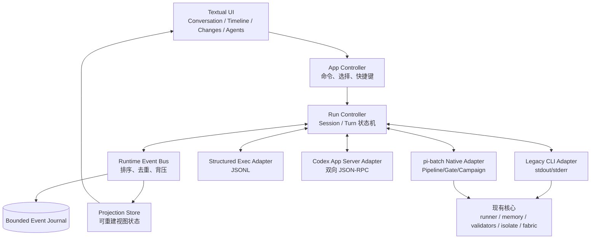

# Codex CLI 核心产品能力分析与 pi-batch TUI 演进设计

> 状态：可信 RuntimeEvent 已统一驱动 Conversation、Status、Timeline 与 workspace
> projection，并在可见前写入 scoped bounded journal；Codex Structured Exec 支持
> provider thread 延续，App Server 双向协议层可通过能力握手显式启用。
> 范围：产品分析、交互模型、运行时协议、实施顺序与验收。当前产品边界是
> 自动启动恢复、provider 持续订阅/远端 archive 仍待接线；App Server sandbox、
> approval policy 与 network 有效值已可在状态区常驻展示；
> session picker、App Server 动作前预对账/typed 审批、独立 Plan/Changes/Agents
> Inspector 与本地 archive 已交付，
> TUI `/review` 已提供只读 scope、
> structured finding 与有界报告；显式 App Server runtime 已接通 inline
`review/start`，并将 typed finding/message evidence 绑定到当前 review turn。

## 1. 结论

Codex CLI 的核心产品不是“终端里的聊天框”，而是一个**可观察、可干预、
可审计的本地 Agent 工作环**：用户在同一会话里提出目标，Agent 读取项目、制定
或更新计划、调用工具、修改文件、运行命令；用户能持续看到发生了什么，在必要时
审批、打断、补充方向，并在结束后审阅仓库变化。

pi-batch 不应逐项仿制 Codex 的命令或视觉外观。更合适的方向是：

1. 保留 pi-batch 的 provider-neutral 执行、Pipeline、Gate、Campaign、Isolate、
   Memory 与 Fabric 优势；
2. 把当前 stdout/stderr 驱动的 TUI 升级为**结构化事件驱动的控制台**；
3. 通过能力协商接入不同 Agent：旧 CLI 继续可用，Codex 可通过 App Server 获得
   深度能力，其他 Agent 按各自适配器渐进增强；
4. 让“运行计划、权限边界、执行证据、文件变化、验证结果”成为一等产品对象，
   而不只是聊天正文中的文本。

最关键的架构决定是：**不从 ANSI 或自然语言 stdout 猜测命令、审批和文件事件。**
当前文本流只适合兼容模式；审批、steering、恢复、子 Agent 和可靠时间线必须建立在
双向结构化协议之上。

## 2. 分析范围与事实基线

本设计以 OpenAI 当前官方资料为事实基线，不把非公开实现或界面细节当作契约。
官方资料显示：

- Codex CLI 在本地仓库中完成读取、修改和命令执行，交互会话与 `codex exec`
  非交互模式并存；交互界面提供模型、权限、状态、Review、恢复、图片、MCP、
  Web 搜索和多 Agent 等入口。[Codex CLI 概览](https://learn.chatgpt.com/docs/codex/cli)
- Slash 命令覆盖模型、权限、状态、计划、压缩、恢复、分叉、Review 和 Agent
  导航；活跃 turn 期间可以排队后续消息。
  [Codex CLI 命令参考](https://learn.chatgpt.com/docs/developer-commands?surface=cli)
- 安全模型明确拆成两个独立维度：sandbox 是技术执行边界，approval policy 是何时
  必须询问用户；默认本地模式限制网络和工作区外写入。
  [Agent 审批与安全](https://learn.chatgpt.com/docs/agent-approvals-security)
- `/review` 是独立的只读审查工作流，能审查未提交变更、基准分支、提交或自定义
  范围；它不等同于简单展示 diff。
  [Code review](https://learn.chatgpt.com/docs/code-review)
- 面向富客户端的 App Server 提供线程、turn、item、增量通知、审批、steering、
  interrupt、resume、fork 和 review 等双向结构化接口；本地 stdio 使用 JSONL，
  WebSocket 仍属实验能力。[Codex App Server](https://learn.chatgpt.com/docs/app-server)
- `codex exec --json` 可输出 thread、turn 和 item 生命周期 JSONL，适合非交互执行
  和遥测，但不应替代富客户端需要的双向协议。
  [Codex 非交互模式](https://learn.chatgpt.com/docs/non-interactive-mode)
- 子 Agent 是可检查、可切换、可 steer/stop 的线程；来自非当前线程的审批必须显示
  来源。并行更适合读多写少任务，写密集任务需要谨慎。
  [Codex 子 Agent](https://learn.chatgpt.com/docs/agent-configuration/subagents)
- 项目指令按全局到项目目录分层发现，离当前工作目录更近的规则覆盖更上层规则；
  TUI 应能解释本轮使用了哪些指令源。
  [AGENTS.md 规则](https://learn.chatgpt.com/docs/agent-configuration/agents-md)
- MCP 和 Skills 分别解决外部工具/上下文接入与渐进式能力说明加载；两者更适合成为
  可发现的能力目录，而不是全部预塞入每轮上下文。
  [MCP](https://learn.chatgpt.com/docs/extend/mcp)、
  [Skills](https://learn.chatgpt.com/docs/build-skills)

其中 App Server 命令及部分传输方式在官方文档中仍标注为实验能力。因此设计必须
包含版本握手、功能开关和兼容回退，不能让 Codex 专有协议成为 pi-batch 的领域模型。

## 3. Codex CLI 的核心产品模型

### 3.1 用户真正购买的价值

用户不是为了“和模型聊天”打开 coding agent，而是为了缩短下面这个闭环：

> 理解项目 → 明确行动 → 执行工具 → 观察证据 → 控制风险 → 审阅变化 → 继续迭代

因此，正文生成质量只是其中一部分。一个成熟 TUI 还必须解决：

- 我当前在哪个仓库、分支、会话和权限模式？
- Agent 此刻在思考、运行命令、改文件、等待审批，还是已经卡住？
- 本轮究竟改了什么，跑了哪些验证，哪些没有执行？
- 我能否在不丢失上下文的情况下补充方向、打断、恢复或分叉？
- 多个 Agent 或流水线角色正在做什么，冲突和风险来自哪里？

### 3.2 八个产品能力域

| 能力域 | 核心行为 | 为什么是核心 |
|---|---|---|
| 工作区感知 | 仓库、分支、dirty 状态、指令源和上下文范围持续可见 | 防止在错误目录或错误规则下执行 |
| 会话生命周期 | new/list/resume/fork/archive，连续 turn 保持上下文 | 长任务不能依赖一次性进程 |
| Agent 工作环 | message、plan、command、tool、file change、validation 逐步呈现 | 用户需要看到证据，而非只等最终回答 |
| 主动控制 | cancel/interrupt、steer 活跃 turn、排队下一条消息 | 长时运行必须可以纠偏 |
| 权限与审批 | sandbox、approval policy、结构化审批卡片和审计 | 自主执行必须有明确边界 |
| 变化与审查 | changed files、diff、按范围 AI review、finding 定位 | “生成代码”之后仍需验证和判断 |
| 扩展与协作 | Skills、MCP、图片、Web、子 Agent 和角色线程 | 让能力按任务扩展，而非把主上下文塞满 |
| 自动化同构 | 交互与 headless 使用同一领域事件和结果语义 | CI、Pipeline 与 TUI 不应成为两套产品 |

### 3.3 核心、增强和外围功能的边界

按用户闭环而不是功能数量排序：

- **P0 核心**：结构化执行事件、稳定会话、取消、工作区变化、权限模式、审批、
  错误恢复；
- **P1 高价值增强**：resume/fork、steer/queue、计划面板、差异导航、AI Review、
  用量和上下文状态；
- **P2 复杂任务能力**：子 Agent 树、Pipeline/Gate 时间线、Artifacts、Skills/MCP；
- **P3 外围集成**：Cloud task、PR 操作、图片预览、远端设备可视化等。

“Slash 命令多”不是产品成熟度指标。命令只是上述领域动作的键盘入口。

## 4. pi-batch 当前能力与差距

### 4.1 已经具备的基础

当前 MVP 的方向是正确的，并且已经有几个可靠底座：

- [`pbatch/tui.py`](../pbatch/tui.py) 提供 Textual 产品壳、对话区、状态栏、
  composer、命令面板、slash 命令、输入历史和窄屏降级；
- [`pbatch/tui_backend.py`](../pbatch/tui_backend.py) 复用现有 runner，保持稳定
  session，转发实时 stdout/stderr，并通过进程组清理实现 cancel；
- [`pbatch/tui_workspace.py`](../pbatch/tui_workspace.py) 提供有界、只读、路径受限的
  Git status/diff，并检测每轮前后的 workspace delta；
- 现有 Memory 已有 tenant/project/sensitivity 边界、索引上限和按需读取；
- Pipeline、Gate、validator、Campaign、Isolate、Fabric 已有远强于普通聊天 TUI 的
  治理信息，只是尚未统一投射到交互界面。

### 4.2 差距矩阵

| 产品能力 | 当前状态 | 主要缺口 | 优先级 |
|---|---|---|---:|
| 无参数进入 TUI、脚本兼容 | 已完成 | 无 | 保持 |
| 单会话连续 turn | 核心闭环完成 | 当前进程自动续轮；overlay picker + 精确 `/resume` 可恢复终态 Codex thread，`/fork` 能力驱动分叉，本地 archive 可逆；App Server resume 已动作前预对账，provider archive 仅显式命令、exact handle 与 capability 可用 | P1 |
| 实时正文与 stderr | Legacy/Structured Exec 已统一经 EventBus/Projection 驱动；Codex 可区分 command/file/plan/usage | command 大输出已自动提升为 data-scoped ArtifactRef，Completion/Artifact Inspector 可查看；仍缺通用 tool 输出引用化 | P1/P2 |
| 取消 | 当前 turn/handle-scoped 已完成 | 富 runtime 的远端 turn 确认、断线对账仍待能力接入 | P1 |
| 工作区状态与 diff | scoped Changes Inspector 已完成 | all/unstaged/staged/untracked/last-turn、base/commit、文件与 hunk 导航可用；active-turn live refresh、统计/二进制视图和 finding 跳转已完成 | P1 |
| AI Review | headless `review` / `review-fix` 与 TUI `/review` 已实现 | TUI 提供只读 scope、结构化 finding、有界报告、`/findings` → Changes 定位；显式 App Server runtime 已接入 inline `review/start`、typed evidence 与 fix 后 exact turn/validation/gate/workspace 报告，`f` 仍走普通 turn | P1 |
| 计划与进度 | Timeline + 独立 Plan Inspector 已实现 | 同一结构化条目驱动两种视图并按 `item_id` 原位更新；validator/gate/actor 与 opt-in native Pipeline stage/task 已进入 typed timeline，PlanSnapshot 已保留 bounded scope/validator/gate/budget 与 plan digest evidence，但仍不具备统一执行授权 | P1/P2 |
| 运行历史与 Agents Inspector | 当前 operation + scoped shared ledger + active/history Actor Tree 已实现 | 最近 100 条终态、过滤/刷新、产物引用、损坏诊断以及 provider/native 的可信 child lineage 与 bounded history groups 可用；显式 authority 的父级能力/范围继承校验已具备，仍缺 provider 根 authority 接入与单 actor 控制 | P1/P2 |
| 每轮 Completion | typed events + authoritative workspace delta 已实现 | `/completion` 已展示 outcome/commands/changes/unfinished plan/checks/risks/usage，并可跳转 Artifact Inspector；仍缺 Pipeline 级聚合 | P1/P2 |
| 权限模式 | 部分实现 | typed approval 已显示；App Server sandbox、network、approval policy 有效值已常驻；write scope 仍待统一事件 | P0 |
| 审批 | App Server typed modal + append-only audit 已实现 | Native/Pipeline exact-run approval channel 已实现；更丰富 namespace 与恢复语义仍待扩展 | P1/P2 |
| steer/queue | 进程内 follow-up queue、能力驱动 `/steer` 与 App Server 主 TUI 已实现 | Structured Exec/Legacy 不支持 live steer | P1 |
| 子 Agent | 编排内核已有并发角色 | active/history typed Actor Tree、Native Pipeline stage/task/meta-role 与声明式 App Server provider child 来源已可见；provider/meta 权限继承仍受根 authority/能力确认约束，单体 stop/steer 仍未提供 | P2 |
| Pipeline/Gate | 内核成熟 | gate/validator 与 opt-in native observer 的 stage/task/meta-role 事件已有 typed timeline 投影；TUI 已支持 `/pipeline FILE` 与 `tui --pipeline FILE` 的 read-only 启动/attach、exact-run approval IPC 和 scoped active-task/cooperative cancel | P2 |
| 能力发现 | 有 Capability Registry | session resume/fork/archive 已按 runtime capability 裁决；其余 TUI 动作尚未统一能力化 | P0 |
| 运行历史 | scope 内 picker、byte-bound 本地摘要、App Server advisory 历史页、精确恢复、可逆本地 archive 与显式 provider archive、checkpoint 完整性见证已完成 | 缺少跳过 replay 的 state snapshot 加速、自动启动恢复与 provider 持续订阅；非 App Server provider archive 仍 unsupported | P1 |

当前事件路径为：

```text
Provider Adapter → canonical RuntimeEvent → durable EventBus
                 → Projection → immutable TUIViewSnapshot → TUI
```

无结构化能力的 backend 仍可通过 Legacy Adapter 把 callback 文本转换为受限事件；
callback 只承担兼容正文与运营诊断，不推断 command、approval、终态或权威文件变化。

## 5. 产品原则与明确决策

### 5.1 产品原则

1. **终端工作环优先**：首页服务于“做事并验证”，不是展示所有子命令。
2. **协议优先**：可靠交互依赖结构化事件和命令，不解析自然语言猜状态。
3. **provider-neutral 核心**：Codex、pi、OpenCode 等是 Adapter，不进入核心状态名。
4. **能力真实可见**：runtime 不支持的动作必须隐藏或禁用并解释原因，不能伪装成功。
5. **安全状态常驻**：workspace、sandbox、approval、network、active actor 始终可见。
6. **证据与正文分层**：命令、diff、validator、usage 不混进 Assistant 正文。
7. **有界和 fail closed**：事件、输出、历史、diff、审批目标均有大小和路径边界。
8. **交互与自动化同构**：TUI、`exec`、Pipeline 共用状态机和事件 schema。
9. **兼容优先**：现有无头 CLI、YAML、runner 和第三方 Agent 配置不被 TUI 绑架。

### 5.2 决策记录

| 决策 | 选择 | 理由 |
|---|---|---|
| 富 Codex 集成 | App Server Adapter | 官方将其定位为富客户端接口，支持双向审批和 steering |
| Codex JSON 模式 | 作为结构化只读/非交互桥接 Adapter | 有事件但不是完整双向控制面 |
| 旧 Agent | 保留 Legacy CLI Adapter | 不能为了富体验破坏现有可移植性 |
| 内部模型 | Session → Turn → Event/Item | 能统一对话、工具、Pipeline 和子 Agent |
| 持久化 | 有界 append-only journal + 可重建 projection | 支持恢复和审计，避免把 UI 状态当真值 |
| Approval | typed request/decision IPC | stdin 模拟无法可靠绑定请求、来源和时效 |
| Review | 独立只读运行类型 | diff 展示与推理审查的权限、模型和产物不同 |
| `events.py` | 不直接复用现有 Fabric ledger 文件 | 现有 schema/归属不同；共享底层有界 JSONL 工具即可 |

## 6. 目标架构



### 6.1 模块边界

建议新增下列领域模块；文件名是建议，不是强制 ABI：

| 模块 | 单一职责 |
|---|---|
| `tui_protocol.py` | 版本化事件、请求、实体和枚举；纯数据模型 |
| `tui_runtime.py` | `AgentRuntime` Protocol、能力协商和 Adapter 注册 |
| `tui_controller.py` | session/turn 状态机、命令路由、超时与恢复 |
| `tui_events.py` | 事件排序、去重、订阅与 disposable projection |
| `tui_journal.py` | scoped bounded journal、durable append、损坏恢复与边界校验 |
| `tui_approvals.py` | request 生命周期、决策校验、审计；不执行命令 |
| `tui_review.py` | review scope、finding schema、只读审查编排 |
| `adapters/legacy_cli.py` | 封装当前 `TUIBackend` 文本能力 |
| `adapters/codex_exec.py` | 解析版本化 `codex exec --json` 事件 |
| `adapters/codex_app_server.py` | App Server 生命周期、通知、server request 与审批 |
| `adapters/pbatch_native.py` | 把 stage/task/gate/validator/Campaign 投射为事件 |

`pbatch/tui.py` 只消费 projection、发出用户 intent，不直接理解 subprocess、Codex
JSON 字段或 Pipeline 内部对象。现有 `TUIBackend` 在迁移期成为 Legacy Adapter，
避免一次性重写。

### 6.2 Runtime 能力协商

每个 Adapter 启动后返回能力集合，例如：

```json
{
  "protocol_version": 1,
  "runtime": "codex-app-server",
  "capabilities": {
    "structured_events": true,
    "session_resume": true,
    "session_read": true,
    "session_fork": true,
    "session_archive": true,
    "turn_steer": true,
    "message_queue": true,
    "typed_approvals": true,
    "review": true,
    "subagents": true,
    "actor_control": false,
    "images": true,
    "usage": true,
    "instruction_sources": true
  }
}
```

规则：

- UI 根据能力启用动作，不以 binary 名称做条件判断；
- 不认识的 capability 忽略，不认识的必需 schema 版本拒绝启动富模式；
- Adapter 断线或降级时发出明确事件，不能静默回落后仍展示可审批状态；
- Legacy Adapter 至少声明 `message_stream=true`、`interrupt=true`，其余为 false；
- App Server 是实验依赖，必须执行 initialize/version handshake，并允许配置禁用；
- capability 是“本次连接真实支持”，不是静态产品宣传。

## 7. 统一领域模型

### 7.1 实体

| 实体 | 说明 | 关键标识 |
|---|---|---|
| Workspace | 当前受控仓库与路径边界 | `workspace_id`, `root`, `head` |
| RuntimeSession | pi-batch 统一会话；映射 provider thread/session | `session_id`, `provider_session_id` |
| Run | 一次直接任务、Pipeline、Campaign 或 Review | `run_id`, `run_kind` |
| Turn | 用户输入到最终状态的一轮 | `turn_id`, `state` |
| Actor | 主 Agent、provider 子 Agent、meta 角色、gatekeeper | `actor_id`, `parent_actor_id` |
| Item | message、command、tool、file、plan、finding、artifact | `item_id`, `item_kind` |
| ApprovalRequest | 一个有期限且绑定具体副作用的请求 | `request_id`, `turn_id`, `actor_id` |
| ArtifactRef | 大对象、报告或 diff 的有界引用 | `path`, `digest`, `media_type`, `bytes` |

`provider_session_id` 与 `session_id` 必须分开。前者由 Codex/pi 等 provider 拥有，后者用于
pi-batch 的审计、跨 Adapter 关联和 data_dir 路由，不能假设两者格式或生命周期相同。

### 7.2 Turn 状态机

```text
QUEUED -> RUNNING -> SUCCEEDED
                  -> FAILED
                  -> INTERRUPTING -> INTERRUPTED
                  -> WAITING_APPROVAL -> RUNNING
                                      -> DENIED -> FAILED|INTERRUPTED
                  -> DISCONNECTED -> RECONCILING -> RUNNING|UNKNOWN|终态
```

约束：

- 终态不可回退；迟到事件保留到 journal，但不得修改已经确认的终态；
- `WAITING_APPROVAL` 是显式状态，不是 stdout 中出现问号；
- cancel 是用户 intent，只有收到 runtime 确认或进程被回收后才进入终态；
- 进程异常退出但无法确定 provider 状态时标为 `UNKNOWN`，不得冒充 failed 或 success；
- `steer` 不新建 turn；queued follow-up 在当前 turn 终态后创建下一 turn。

### 7.3 事件 Envelope

```json
{
  "schema_version": 1,
  "event_id": "evt_...",
  "seq": 42,
  "occurred_at": "2026-08-21T12:00:00Z",
  "workspace_id": "ws_...",
  "session_id": "ses_...",
  "run_id": "run_...",
  "turn_id": "turn_...",
  "actor_id": "agent_main",
  "kind": "command.completed",
  "payload": {
    "item_id": "item_...",
    "exit_code": 0,
    "elapsed_ms": 812,
    "output_ref": {"path": "...", "digest": "sha256:...", "bytes": 4096}
  }
}
```

首版事件类型：

- `session.created|resumed|forked|archived|disconnected`；
- `turn.queued|started|steered|interrupting|completed|failed|interrupted`；
- `message.started|delta|completed`；
- `plan.updated`；
- `command.started|output|completed`；
- `tool.started|completed|failed`；
- `file.changed`、`workspace.snapshot`；
- `validation.started|completed`、`gate.verdict`；
- `approval.requested|resolved|expired`；
- `actor.spawned|status|completed`；
- `review.finding`、`artifact.created`、`usage.updated`；
- `runtime.warning|error|capabilities_changed`。

事件要求：

- 每个 run 内 `seq` 单调递增，`event_id` 幂等去重；
- delta 允许合并显示，但 journal 保留协议需要的最小审计信息；
- 大 stdout、diff、图片、报告不内嵌 journal，写入 data_dir 后以 digest 引用；
- 单事件、单 item、单 journal 和展示缓冲均有独立上限；
- Adapter 原始字段放在有界 `extensions`，不能污染核心 schema；
- agent 输出始终是不可信数据，事件 `kind` 只能由受信 Adapter 产生。

### 7.4 PlanSnapshot

Plan 不只是步骤列表，应同时表达执行边界：

```text
goal
steps[]: id / title / state / actor / dependencies
read_scope[] / write_scope[]
commands[] / network_intent[] / external_tools[]
validators[] / gates[]
budget: time / attempts / tokens / devices
assumptions[] / unknowns[] / stop_policy
source: provider | pipeline | deterministic-preflight
```

原生 runtime 有 plan event 时直接映射；没有时，pi-batch 可用 Task/Pipeline 配置生成
`deterministic-preflight` 计划，但必须标注来源，不能把协调器推导冒充模型承诺。

当前 Plan 实现已落地 Timeline 与独立 Inspector 切片：Codex Structured Exec Adapter 将
`todo_list` 映射为 provider-neutral `plan.updated`；structured backend 把原始
`RuntimeEvent` 交给 presentation controller，controller 再更新当前 turn 的有界
Timeline 快照。没有 raw event sink 的兼容调用才使用文本 notice。同一 `item_id`
的后续更新在原卡片上替换，摘要显示完成数，expanded 视图显示每步状态与标题；
输入项数、单项文本和展示详情均有独立上限。`/plan` 读取该 Timeline 条目附带的
结构化 `PlanSnapshot`，因此可展示超出 2 KiB Timeline 预览的完整有界步骤，并在
打开期间随事件刷新，而不复制状态源或污染 transcript。snapshot 还保留 provider 明确
给出的 goal、read/write scope、commands、network intent、external tools、validators、
gates、budget、assumptions、unknowns、stop policy 和 version；这些字段是有界展示证据，
不自动变成执行授权，统一的执行边界绑定仍待后续完成。

Assistant 正文同样按领域 `item_id` 投影：同一 item 的 `message.completed` 只替换
该 item 的 provisional delta，不覆盖同一 turn 中其他 message item；无 `item_id`
的 Legacy 流仍保持单流语义。所有 message item 共享当前 turn 的 64 KiB UTF-8
展示预算，而不是每 item 各占一份预算。provider item id 使用 `raw:` / `sha256:`
命名域分离；超长值携带原值摘要，避免共享前缀或伪装成摘要值的不同 item 在投影前
碰撞。

## 8. 关键交互设计

### 8.1 主屏信息架构

主屏保持一条工作主线，避免把全部子命令做成菜单墙：

- **Header**：workspace/branch、session、model、sandbox、approval、context budget；
- **Conversation**：用户消息与 Assistant 正文，只承载叙事内容；
- **Timeline**：plan、command、tool、file、validator、gate 事件卡片，可折叠；
- **Inspector**：Status / Plan / Changes / Agents 四个投影视图；
- **Composer**：多行输入、文件/图片引用、send/steer/queue 模式提示；
- **Overlay**：session picker、review scope、approval、command palette。

窄屏时 Inspector 变成快捷键打开的全屏 overlay；Composer 和当前风险状态不得隐藏。

### 8.2 Composer 与运行中控制

当前合同：

- agent turn busy 时 composer 保持可输入，普通文本进入本地 FIFO follow-up queue；
- 队列为当前 TUI 进程协调能力，不冒充 runtime `message_queue`；上限为 16 条、
  总计 64 KiB、单条 16 KiB，可查看、编辑、删除和清空；
- 当前 turn 成功后自动启动队首；失败或取消时保留并暂停，且只有新 turn 真正启动后
  才从队列删除；session/runtime 切换时清空并显式告警；
- `/steer <text>` 仅在已初始化 runtime 声明 `turn_steer` 且存在匹配 live handle 时
  后台发送；能力检查不允许重初始化活动 runtime；
- Codex Structured Exec 与 Legacy 当前均 fail closed。App Server Adapter 的
  `turn/steer` 协议实现只有在主 TUI 接线并完成握手后才可用；
- 来自 Adapter 的可信 `turn.steered` 进入 Timeline，正文不能伪造控制成功；
- cancel、interrupt 和 stop actor 是三个不同 intent，不共用模糊按钮。

### 8.3 Session

当前已交付：

- `/sessions`：在独立 overlay 中只列当前 resolved workspace/memory scope 内通过边界
  校验的最近 journal；索引不写入 conversation transcript；
- `/resume <id>`：精确重建可信投影；仅在 journal 终态可写、provider handle 可用、
  runtime 匹配且 capability 支持时执行续跑，否则只读；
- 显式 Codex resume 标为 required，provider 拒绝时 fail closed，不回退新会话；
- picker `f` / `/fork [id]`：仅在 `session_fork` capability 和来源证据匹配时，
  创建新本地 session，并要求下一 turn 执行真实 provider fork；
- picker `a` / `/archive <id>` / `/unarchive <id>`：锁内写入或移除本地可逆标记，
  不删除 journal；archive 后 append fail closed，活动或未决 session 拒绝归档。Provider
  thread 则必须通过显式 `/provider-archive <id>` / `/provider-unarchive <id>`，不与本地
  marker 混淆。
- picker 在已截断的本地记录上读取 byte-bound 小型摘要，显示 runtime、可信 branch、
  最后 turn 状态和有界完成消息；缺失/陈旧/损坏缓存诚实显示 unavailable；
- App Server `thread/list` 以 typed page、固定 cwd/source kinds 和保留 `nextCursor` 的
  advisory 形式精确合并 name/preview/status/model provider；RPC 在 UI worker 中执行。

后续新增：

- provider 持续状态订阅、自动启动恢复与真正 projection checkpoint；provider archive
  已接通 App Server exact thread API，但其他 runtime 仍保持 unsupported。
- 仅在后续可信事件实际提供时补齐具体 model 等字段，不把 modelProvider 冒充 model。

恢复流程必须先检查 workspace 身份和 runtime 能力。跨仓库恢复要显式确认或拒绝，
不能因为同名 session 自动切换目录。Memory 索引可用于发现候选，但历史文本本身不是
可执行指令，也不能替代 provider 的真实 resume。

### 8.4 权限与审批

Header 常驻显示两个维度：

```text
Sandbox: workspace-write    Approval: on-request    Network: off
```

审批卡片至少包含：

- 来源 session/turn/actor；
- 操作类型：command、file write、network、MCP/app、device、其他副作用；
- 规范化 argv、cwd、目标路径/主机/工具和请求理由；
- 命中的策略、超出当前边界的具体部分、风险等级；
- 选择：allow once、allow for session（仅 runtime 支持时）、deny、interrupt；
- request id、创建时间、失效时间和 amendment 范围。

安全不变量：

1. UI 不解析 stdout 生成审批；
2. decision 必须绑定 request id、turn id、actor id 和当前连接；
3. 迟到、重复、已失效或跨 session decision 一律拒绝；
4. “本次允许”不能静默升级为 session policy；
5. 子 Agent 审批必须显示来源，即使它不是当前 Inspector 中的 actor；
6. 退出或断线时保持 fail closed，不能默认 allow；
7. 所有 request/decision 追加审计事件，但敏感参数按数据级别脱敏；
8. Fabric 的 capability approval 与本地 Agent approval 分属不同 namespace，
   UI 可统一展示，但 Controller 不得混发 decision。

### 8.5 Changes 与 Review

Changes 视图支持以下 scope：

- unstaged、staged、untracked；
- 当前 turn 观察到的变化；
- 与 base branch 的差异；
- 指定 commit；
- 全部当前工作区变化。

当前 `/changes [scope] [path]` 与 Ctrl+G 已在独立 overlay 中支持
all/unstaged/staged/untracked/last-turn；`/changes base REF [path]` 与
`/changes commit REF [path]` 先验证 ref，再执行参数化只读 Git 比较。文件列表按
Enter 选择，`n`/`p` 在有界 unified diff hunk 间导航，`r` 刷新；`/files`、
`/diff [path]` 保留为 transcript 兼容输出。当前 active turn 期间仍 fail closed；
active live snapshot、统计/删除/二进制提示和 `/findings` 安全路径/行号跳转已交付。

`/findings` 读取 completed review 的结构化 payload 或可信 `review.finding` 事件，
在创建 `ChangesRequest` 前拒绝绝对路径、遍历、控制字符和无效行号；目标 hunk 仅由
unified diff header 选择，缺失 diff 仍显示 unavailable，不修改工作区。

`/review` 启动独立的 `run_kind=review`：

- review 默认只读，不修改 worktree；
- scope 在启动前明确；
- finding 使用 `severity/file/line/problem/evidence/fix_hint` 结构；
- finding 可跳转到 diff；
- `f` 明确启动一个普通 turn，重新遵守当前权限与验证门禁；finding 文本被标记为不可信数据；
- 机械 diff、validator 结果和 AI finding 分栏展示，不能混称“已验证”。

### 8.6 Plan、Timeline 与完成报告

Timeline 卡片的默认密度：

- 正在运行和失败事件展开；
- 成功 command/tool 默认折叠为一行；
- stdout/stderr 有界预览，完整内容按 ArtifactRef 打开；
- plan 更新不重复追加整份计划：当前 Timeline 已按相同 `item_id`
  原位更新有界卡片，摘要和 expanded 步骤均可见；独立 Plan Inspector 复用同一
  结构化条目展示完整有界步骤，后续仍需执行边界与版本差异；
- 每轮 completion projection 已交付：`/completion` 直接读取 immutable snapshot，活动
  turn 中原位更新，展示改动、命令、显式验证/Gate、未完成 Plan、风险和用量。每类
  动态证据独立设限并报告截断；没有 event 就不声称通过，正文不能伪造事实。

这与仓库现有 completion/evidence/gate 纪律一致：UI 只能说“validator 通过”或
“reviewer 认为通过”，不能把模型陈述升级为工程门禁事实。

### 8.7 Agents

当前已交付的 `/agents [agent]`（`/runs` 别名）是有界运行 Inspector，并在可信
runtime projection 存在时叠加 active-turn Actor Tree 与 retained history groups：活动 TUI
turn/review 以 coordinator fact 标为 `current`，历史树按 trusted actor event 的 turn/run
绑定聚合，`h` 在当前树与历史树间切换；终态运行记录仍从当前 data_dir 的共享账本读取。
agent/status 过滤、刷新、run/session/attempt/耗时/退出码和产物引用均不进入 conversation
transcript。损坏、超长或超过 projection 容量的记录显式跳过并报告，Actor Tree 只接受同一
turn/run 的 typed parent lineage；没有 `actor_control` capability 与精确 actor identity
时仍不开放单 actor stop/steer。

后续统一 Actor Tree 仍需补充权限继承、跨运行的 provider archive 关联和单 actor 控制；
历史视图不会把共享账本摘要冒充成 provider actor 事实。

每个节点显示 owner/runtime、父节点、任务、状态、耗时、权限继承、变更范围和最后
事件。支持 inspect、steer、stop 的前提是对应 runtime capability 为 true。

当前 `/agent [binary]` 与 Codex 风格的“切换子 Agent”语义冲突。兼容演进建议：

- 新增 `/runtime [binary]` 修改执行器；
- `/agents` 在 runtime 提供可信 actor 事件后，从运行历史渐进展开 Actor Tree；
- 旧 `/agent [binary]` 保留一个弃用周期并提示迁移；
- 不直接把 Codex 的 `/agent` 语义硬编码到通用 UI。

并行写任务默认不自动扩大：同一 worktree 上多个 writer 必须由 waves/hypergraph 判断
无冲突，或走现有 Isolate worktree；读多写少任务可以更积极并发。

### 8.8 Skills、MCP 与 Capability Registry

命令面板应合并三种“可做什么”：

- pi-batch Capability Registry：稳定、可治理的产品能力；
- runtime capabilities：本次连接支持的交互动作；
- Skills/MCP：按任务渐进发现的知识与外部工具。

列表只加载名称、说明、风险和连接状态；只有用户显式选择或任务命中时才读取完整
Skill 指令或 MCP schema。MCP 调用作为 tool event 呈现，side-effecting tool 继续走
typed approval，不因为“来自 MCP”而降低边界。

## 9. Adapter 设计

### 9.1 通用接口

```python
class AgentRuntime(Protocol):
    def runtime_info(self) -> RuntimeInfo: ...  # cached; non-blocking; no handshake
    def initialize(self, request: InitializeRequest) -> RuntimeInfo: ...
    def list_sessions(self, query: SessionQuery) -> SessionPage: ...
    def read_session(self, request: ReadSessionRequest) -> RuntimeSessionObservation: ...
    def start_session(self, request: StartSessionRequest) -> RuntimeSession: ...
    def resume_session(self, request: ResumeSessionRequest) -> RuntimeSession: ...
    def fork_session(self, request: ForkSessionRequest) -> RuntimeSession: ...
    def start_turn(self, request: StartTurnRequest) -> TurnHandle: ...
    def steer_turn(self, request: SteerRequest) -> None: ...
    def interrupt_turn(self, request: InterruptRequest) -> None: ...
    def resolve_approval(self, decision: ApprovalDecision) -> None: ...
    def events(self) -> Iterator[RuntimeEvent]: ...
    def close(self) -> None: ...
```

具体实现可以是线程、asyncio、stdio 或 socket，但 Controller 只依赖上述语义。
所有回调进入 Textual 前必须 marshal 到 UI thread；阻塞 IO 不得运行在事件循环中。
能力展示与迟到 worker 复验只读取 `runtime_info()`；缺少该本地缓存接口时 fail closed，
不得为了打开 picker 在 UI thread 重入 `initialize()`。

### 9.2 Legacy CLI Adapter

由当前 `TUIBackend` 演进而来：

- stdout → `message.delta`；
- stderr/log → `runtime.warning` 或有界 operational stream；
- `TaskResult` → `turn.completed|failed`；
- workspace before/after → `workspace.snapshot`、`file.changed`；
- 已迁移为 handle-scoped interrupt：`PREPARING` 阶段取消可阻止 backend 调用，
  且不会误调用尚未启动的 provider cancel hook；`START_COMMITTED` 后以 backend
  的取消接受结果为准，拒绝取消时保留真实终态并告警，cancel hook 异常后允许重试，
  不伪报 `INTERRUPTED`；
- session flags 继续由现有 adapter 配置解析。

它不宣称支持 typed approval、steer、subagent 或可靠 tool events。即使输出恰好是 JSON
或包含 `Approve?`，也不能提升 capability。

### 9.3 Codex Structured Exec Adapter

适合先验证事件模型：

- 使用 argv 启动，无 shell 拼接；
- 解析 `codex exec --json` 的 JSONL，映射 thread/turn/item 生命周期；
- 未知 item 保留为 `runtime.unknown_item`，不导致整个 run 崩溃；
- stdout 中的非 JSON 行按协议错误处理，不静默降级；
- 适合非交互任务、回放和 CI 同构测试；
- 由于缺少完整双向 server request，不作为审批和 steering 的最终实现。

无 raw event sink 的兼容 callback 在 canonical completion 不是 provisional delta
前缀时发出显式 `stdout-replace`，避免追加式 `stdout` 让界面永久停留在 draft；当前
TUI 会原位替换活动 assistant 条目。

### 9.4 Codex App Server Adapter

映射建议：

| App Server | pi-batch 领域 |
|---|---|
| thread | RuntimeSession |
| turn | Turn |
| item | Item + typed RuntimeEvent |
| notification | RuntimeEvent |
| server request | ApprovalRequest 或用户输入请求 |
| thread/start/resume/fork | Session commands |
| thread/archive/unarchive | Provider session archive commands |
| turn/start/steer/interrupt | Turn commands |
| review/start | Review Run |

实现约束：

- 首版只用本地 stdio JSONL；不依赖实验 WebSocket；
- 严格关联 JSON-RPC request id，处理通知与响应乱序；
- 初始化时记录 server/version/schema 能力，契约测试固定已支持版本；
- child process 独立进程组，关闭顺序为停止新请求 → resolve/deny outstanding
  approvals → interrupt active turns → terminate → hard kill/reap；
- app-server 原始 transcript 由 Codex 拥有，pi-batch journal 只保存必要投影和引用；
- 任何解析、连接或能力变化都发出结构化 error，不把协议文本渲染成 Assistant 正文。

### 9.5 pi-batch Native Adapter

Native Adapter 让 TUI 成为现有产品能力的入口，而不是只包装一个 Agent：

- Pipeline → run；Stage → actor group/plan step；Task → child turn/item；
- validator → validation event；gate → gate verdict；approval stage → approval request；
- meta role → actor child；gate-fix → remediation child run；Actor Tree 只接受同一
  turn/run 内已 spawn 且 parent 匹配的 child actor；
- artifact/archive/decision log → ArtifactRef；
- Campaign/Isolate/Fabric 只在用户显式启动对应能力时进入控制面。
- `pipeline.run_pipeline(..., event_sink=...)` 已提供只读 observe bridge；TUI 通过显式
  `app.attach_native_pipeline(workspace_id)` 接入该 sink，先使用独立 bounded Projection，
  在 workspace path 与 journal 可用时再为首个 exact native session 懒绑定独立 journal/
  checkpoint；不会把 Pipeline 启动、取消或 approval 控制冒充为直接 turn 操作。
- TUI 用户可通过 `/pipeline <file> [--reuse]` 或 `tui --pipeline FILE` 显式启动
  Pipeline；启动沿用既有 runner，approval stage 通过 exact-run-scoped control
  channel 决策，whole-pipeline cancel 仅做本地 cooperative stop，不发送 provider stop。

控制面仍保持窄边界：approval 只解锁当前 exact run，cancel 只在本地
Pipeline stage 边界生效，不重写 provider turn 或发送 provider stop。

## 10. 持久化、恢复与一致性

### 10.1 数据位置

已交付的事件日志继续遵守 `config.data_dir(cwd)`，实际布局为：

```text
<data_dir>/tui/
  events/<scope-digest>/<session-digest>/
    meta.json
    events.jsonl
    journal.lock
    append-intent.json     # pending append 的持久意图；存在时恢复优先回滚
    append-commit.json     # intent 已持久清除后的提交确认；可在清理窗口残留
    read-only.json         # 共享 fail-closed 锁存，不用于选定单条事件边界
    checkpoint.json         # 有界 projection digest 见证，不是恢复授权或状态快照
    archived.json          # 可逆本地生命周期标记，不代表 provider archive
```

原始 session id 不进入路径；`meta.json` 绑定 schema、session、resolved cwd 与
tenant/project_id/sensitivity，目录和文件分别收紧为 0700/0600。一个逻辑 session
跨多个 run 共用一条有序流，以保留跨轮顺序。`tui.journal_enabled` 默认开启，
`tui.journal_max_bytes` 默认 16 MiB；也可整体通过 `--data-dir` / `PBATCH_DATA_DIR`
外置。overlay session index 已从该布局安全派生；`checkpoint.json` 是按精确 journal
边界写入的有界 projection 完整性清单，只作为可丢缓存/一致性见证，不是状态恢复快照、
执行授权或全局聊天数据库。artifact 目录和跳过 replay 的状态快照加速仍是后续能力。

### 10.2 真值层级

1. provider thread/session 是 provider 对话真值；
2. runner/Pipeline/Gate/validator 是本地执行与验证真值；
3. append-only runtime journal 是 UI 审计真值；
4. projection 是可删除、可重建的展示缓存；
5. Assistant 正文和历史消息是不可信陈述。

### 10.3 当前恢复合同

- 可信事件遵守 durable-before-visible：只有 append 已完成持久 finalize 后，才进入
  内存队列、订阅者和 projection；写入边界存在歧义时锁存只读，不猜测成功。
- 恢复只应用完整、有序且边界匹配的可信前缀。仅 crash-truncated tail 可自动截断；
  完整坏记录、非法状态、重复或乱序会隔离后缀并共享只读状态。
- 已确认终态保持不变；所有未决 turn 恢复为 UNKNOWN，Controller 保持只读，等待
  显式对账。合法 late audit 可持久化，但不回退 turn 终态；权威
  `workspace.snapshot` 仍可更新。
- journal、单行、run 和投影实体都有上限；耗尽时开启新 session，不静默覆盖。
- 当前可在 scope 内通过 overlay 精确选择 session，重建 disposable projection；匹配
  Codex capability/handle 的终态 session 可在下一 turn 执行续跑或 fork，并可用本地
  可逆标记归档；provider thread 的远端归档/恢复通过显式 archive command 和
  `session_archive` capability。App Server resume 会先用不加载、不订阅的 `thread/read` 对账 provider
  状态，只有 `notLoaded`/`idle` 放行；`active`、`systemError`、未知或读取失败时只展示
  本地可信历史。当前 `checkpoint.json` 只验证精确 journal 边界与 projection digest，
不跳过可信 replay；自动启动恢复仍属于下一恢复层。
- `/sessions` 的 `summary.json` 只是与精确 journal byte size 绑定的可丢展示缓存；
  App Server `thread/list` 也只是带观测时间的分页快照。两者都不能替代上述完整恢复与
  动作时 `thread/read`，也不会把 remote-only thread 提升成本地可执行 session。

append intent/finalize、commit-only 恢复和共享 fencing 的实现合同见
[`t17-journal.md`](tui-phase0/t17-journal.md)。

## 11. 安全与失败模型

| 风险 | 防线 |
|---|---|
| stdout 伪造审批/成功 | 只有 Adapter 能产生 typed event；正文永不改变控制状态 |
| 路径穿越 | Workspace/ArtifactRef resolve 后必须位于授权 root/data_dir |
| 超大事件耗尽内存 | line/item/journal/display 四层上限，大对象引用化 |
| 事件乱序/重复 | request id、event id、seq、终态单向约束 |
| 子 Agent 隐蔽副作用 | actor 来源常驻、权限继承可见、非当前 actor 审批主动浮出 |
| 断线后误批准 | request 绑定连接 epoch，断线全部失效，fail closed |
| 全局 cancel 误伤其他 run | 每个 runtime/turn 保存专属 process handle 或 remote id |
| live diff 与写入竞态 | 只读快照、标记时间/HEAD/fingerprint、debounce，不宣称原子视图 |
| 供应商协议变更 | capability handshake、schema 版本、契约 fixture、Legacy 回退 |
| 敏感数据入日志 | scope 按 sensitivity 隔离；payload/extensions 做 best-effort 模式脱敏，identity 固定摘要，疑似含 secret 的 envelope id 或映射键直接拒绝；尚未命中模式的 command/raw 字符串仍可能落账，调用方不得把 journal 当 secret store |

## 12. 分阶段实施路线

### Phase 0：协议地基

目标：不改变当前用户能力，先把 TUI 从文本 callback 解耦。

- 定义 `RuntimeEvent`、实体 id、状态机和 `RuntimeCapabilities`；
- 用 Legacy Adapter 把现有 stdout/stderr/TaskResult/workspace delta 映射成事件；
- 建立内存 EventBus 与 projection；UI 只读 projection；
- cancel 绑定具体 runtime handle，去除 TUI 对全局 active proc 的长期依赖；
- 加入事件排序、重复、合法 late audit 保留/终态不回退（含
  `workspace.snapshot` 例外）、大小上限和 UI thread 边界测试。

完成标准：现有 TUI 行为不退化；FakeBackend 测试改为 FakeRuntime 事件；任意正文不能
伪造 command/approval/turn success。

当前合同：Legacy 与 Structured Exec 共用 canonical EventBus、单向 Projection 和
immutable snapshot；Textual 只在 UI 线程渲染快照。正文、事件、实体与可见历史均
有界，provider observed path 与权威 Git delta 分层。持久恢复能力属于后续恢复层，
不改变 Phase 0 的内存事件合同。

### Phase 1：核心单 Agent 产品环

目标：会话、计划、变化和结构化执行可用。

- overlay session picker、resume、fork 与本地 archive/restore 已交付；
- Timeline 与独立 Plan/Changes Inspector（已交付基础闭环）；
- 当前 operation + shared ledger 驱动的独立 Agents Inspector 已交付；
- Structured Exec Adapter，显示 command/tool/file/plan/usage item；
- active turn 的有界本地 queue 与能力驱动 `/steer` 控制路径已交付；
- bounded diff、scope/ref 选择、last-turn change set 与文件/hunk 导航已交付；
- typed event + authoritative Git delta 驱动的每轮 Completion Inspector 已交付。
- typed `artifact.created` 驱动的 Artifact Inspector 已交付 workspace/data scope UTF-8
  普通文件 64 KiB no-follow 预览；远程/越界/链接/目录/二进制 fail closed；Structured
  Exec aggregate 与 App Server delta/aggregate 的大输出已自动进入私有 bounded ring。

完成标准：退出重开后能恢复 session 投影；不支持 resume/steer 的 Adapter 明确禁用；
1 MiB 级命令输出不阻塞 UI 且只通过 ArtifactRef 展开。

当前合同：Structured Exec 的 message、plan、command、file、usage、terminal 与
workspace snapshot 共用同一个有界 Controller，并可从精确 session journal 重建。
Phase 1 的剩余闭环是“修复此 finding”；session 索引摘要、App Server advisory 历史页、
动作前预对账、live steer、active-turn live diff 和安全 finding 跳转已完成；完整
provider/meta actor 历史树与单 actor 控制属于后续富事件层。

### Phase 2：Codex 富集成与安全闭环

目标：达到 Codex-class 的双向控制体验。

- Codex App Server Adapter、initialize/version/capability handshake（已完成）；
- typed approval modal 与不可变审计（已完成）；
- sandbox/approval/network 状态常驻（App Server 有效值已接通；缺失字段明确显示未知）；
- turn steer/interrupt、provider resume/fork（主 TUI 已接线）；
- 独立 `/review`，支持 uncommitted/base/commit/custom scope；TUI 呈现只读
  structured finding，`/findings` 可安全定位到 Changes；显式 App Server runtime 使用
  inline `review/start` 并回收有界 typed evidence；`f` fixer 仍只走普通 turn；
- app-server 异常、断线、重连、outstanding request 清理测试。

完成标准：审批不能由 stdout 触发；跨 session/过期 decision 被拒；断线默认不放行；
review 不改 worktree；App Server 不可用时可显式回退 Legacy，而不伪装富能力。

### Phase 3：pi-batch 原生编排可视化

目标：把本仓库真正的差异化能力带入 TUI。

- Native Adapter 已通过 opt-in `event_sink` 投射 Pipeline/Stage/Task/validator/gate；
- TUI 已通过 `attach_native_pipeline(workspace_id)` 支持 attach/observe，严格限制同
  workspace 的 `pbatch-native`/`read_only` 事件；start 仍须显式，approval 使用独立
exact-run channel，cancel 仅做本地 cooperative stop、不发送 provider stop；
- gate finding、gate-fix、completion report 结构化展示；
- Campaign/Isolate session 与 worktree 状态联动；
- 决策日志和 Memory 只保存引用，避免上下文复制。

完成标准：同一事件模型既能显示直接 Agent turn，也能显示 Pipeline；Gate FAIL 不会被
正文 PASS 覆盖；用户能定位失败 stage、validator、证据和现场路径。

### Phase 4：多 Agent 与扩展生态

目标：复杂任务的并发协作可控。

- 扩展当前 active-turn Actor Tree，加入 inspect/steer/stop 和来源审批；
- provider 子 Agent 与 meta role 的统一历史/实时投影；
- Skills/MCP/Capability 目录与渐进加载；
- 写冲突检测、waves 和 Isolate 引导；
- 图片、Web、MCP resource 等富 item renderer。

完成标准：非当前 actor 的审批不会被遗漏；两个 writer 不会在未隔离且冲突未知时被
UI 自动并发启动；扩展未连接时界面解释前置条件。

## 13. 验收策略

### 13.1 确定性契约测试

- 事件 schema round-trip、未知字段、未知事件、版本不兼容；
- seq 乱序、重复 event id、迟到 delta、终态后事件；
- session/turn/actor/request id 错配；
- 单行、单 item、单 journal、ArtifactRef 大小和路径上限；
- approval allow-once/session/deny/expire/disconnect；
- capability true/false 对应动作显隐和服务端再次校验；
- crash recovery、projection 重建、截断 journal，pending/committed marker、
  commit 目录 fsync 歧义与跨实例 read-only fence；
- session switch 在队列容量、目标 journal 只读和旧 pending 事件上保持原子性，
  可写旧事件只进旧 journal，不可写旧事件隔离且不串入新 session；
- workspace live snapshot 与路径逃逸；
- Adapter 协议错误不污染 Assistant 正文。

### 13.2 Adapter 契约测试

所有 Adapter 运行同一套最小契约：

1. initialize 后给出真实 capability；
2. start turn 产生且仅产生一个合法终态；
3. interrupt 可回收资源；
4. 不支持的方法返回 typed unsupported，而非 AttributeError 或假成功；
5. 断线关闭 outstanding request；
6. 原始输出达到上限时仍可排空子进程并回收；
7. session/provider id 映射稳定。

Codex Adapter 使用录制且脱敏的官方 schema fixture 做兼容测试，再以可选 integration
test 连接本地已安装版本；CI 不依赖外部账户或网络。

### 13.3 TUI 无头测试

- 宽屏/窄屏、overlay、焦点和 terminal restore；
- message delta 合并、timeline 折叠、active event 自动滚动；
- send/queue composer 状态、队列成功续发/失败暂停，以及 capability-driven steer；
- approval 来源、倒计时、快捷键和 deny 默认；
- session picker 恢复、跨 workspace 提示；
- Changes scope、finding 跳转、截断提示；
- 运行期间查看 live diff 不阻塞 event consumption；
- 屏幕中不存在 secret/env 原值。

### 13.4 仓库门禁

每个 Phase 至少通过：

- 新增协议/Adapter/TUI 单元和集成测试；
- `python quality.py --strict`；
- `python pi-batch.py eval`；
- 完整 `make ci`；
- headless `-p`、stdin pipe、`--json` 和所有既有子命令零 TUI 控制序列回归。

## 14. 成功指标

第一阶段不以“命令数”计成功，使用这些可观测指标：

- 首次可见执行事件延迟 p95；
- cancel 到进程/turn 终止延迟 p95；
- session 恢复成功率与 UNKNOWN 比例；
- structured event 覆盖率：富 Adapter 中落到 `runtime.unknown_item` 的比例；
- 审批请求的来源完整率、过期决策拒绝率；
- review finding 到文件/行的可定位率；
- UI 内存峰值与超大输出时事件消费滞后；
- 用户从失败卡片定位到 validator/证据路径所需操作数；
- Legacy/headless 回归数。

## 15. 明确不做

- 不复制 Codex 品牌、配色、文案或全部 slash 命令；
- 不把任意 Agent stdout 私有格式当长期协议；
- 不在首版实现 Cloud task、PR push/merge 或远端设备全功能控制；
- 不让 TUI 自动批准 Pipeline、MCP、Fabric 或系统命令；
- 不为每个 pi-batch 子命令手写表单；后续由 CommandSpec/Capability schema 生成；
- 不把模型 review 当工程 validator，也不把 diff 展示当 review；
- 不在同一 worktree 无约束并发多个写 Agent；
- 不另造绕过 `data_dir`、Memory scope 和敏感级别的历史库。

## 16. 建议的下一实施批次

后续按依赖顺序推进：

1. App Server review/fixer 的修复后证据回收、exact turn 关联与 validation/gate/workspace
   证据已完成；继续保持权限与验证门禁，不自动标记 finding resolved；
2. 扩展 provider/meta Actor Tree 的历史聚合与能力驱动控制；当前 active-turn
   lineage、声明式 App Server provider child 来源与 actor-control 校验已由
   [`t34-actor-tree.md`](tui-phase0/t34-actor-tree.md) 承接；
3. 为 native Pipeline 补充更丰富的 active-task 控制、更多控制能力与恢复语义；当前
   TUI 已有 exact-run approval/scoped active-task cooperative cancel，启动/只读 attach 与 stage/task
   child actor lineage 由 [`t33-native-pipeline-observer.md`](tui-phase0/t33-native-pipeline-observer.md)
   承接，控制边界由 `t38-native-pipeline-control.md` 承接；
4. 后续恢复层再推进 projection checkpoint、自动启动恢复与 provider 持续订阅；App Server
   provider archive 已保持显式、能力驱动且与本地 archive 分离。

下一步承接 provider actor 历史聚合、active-task stop、真实 Pipeline 恢复入口和
checkpoint；所有面板继续只消费现有可信投影。
