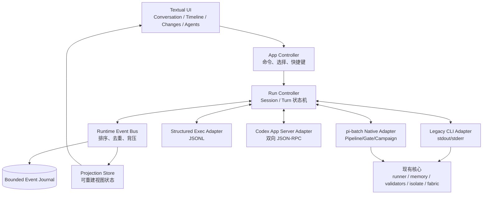

# Codex CLI 核心产品能力分析与 pi-batch TUI 演进设计

> 状态：**Phase 0 已完成 + Phase 1 核心达成（2026-08-21 证据闭环）** · 基线日期：2026-08-21 ·
> 范围：产品分析、交互模型、运行时协议、分阶段实施与验收。
> Phase 0（协议地基）已实现：`pbatch/tui_protocol.py`（T1）、`pbatch/tui_runtime.py` +
> `pbatch/tui_adapter_legacy.py` + `pbatch/tui_events.py`（T2）、TUI 接线与
> handle-scoped cancel（T3）；Phase 1 核心：Codex Structured Exec Adapter
> （`pbatch/tui_adapter_codex.py`，T4）、config session-led argv 与 adapter
> resume/fork（T5）、headless thread 捕获/映射与 `--session-mode shared` 跨任务
> codex 会话延续（T6，端到端验证：第二轮真实恢复第一轮记忆）。
> 交付物见 `docs/tui-phase0/`；`make test` 1754 + 53 eval + quality --strict 全绿。
> 未完：Phase 1 的 TUI session picker/Inspector 视图与 Phase 2（Codex App Server、
> typed approval、/review）为后续批次。

## 1. 结论

Codex CLI 的核心产品不是“终端里的聊天框”，而是一个**可观察、可干预、
可审计的本地 Agent 工作环**：用户在同一会话里提出目标，Agent 读取项目、制定
或更新计划、调用工具、修改文件、运行命令；用户能持续看到发生了什么，在必要时
审批、打断、补充方向，并在结束后审阅仓库变化。

pi-batch 不应逐项仿制 Codex 的命令或视觉外观。更合适的方向是：

1. 保留 pi-batch 的 provider-neutral 执行、Pipeline、Gate、Campaign、Isolate、
   Memory 与 Fabric 优势；
2. 把当前 stdout/stderr 驱动的 TUI 升级为**结构化事件驱动的控制台**；
3. 通过能力协商接入不同 Agent：旧 CLI 继续可用，Codex 可通过 App Server 获得
   深度能力，其他 Agent 按各自适配器渐进增强；
4. 让“运行计划、权限边界、执行证据、文件变化、验证结果”成为一等产品对象，
   而不只是聊天正文中的文本。

最关键的架构决定是：**不从 ANSI 或自然语言 stdout 猜测命令、审批和文件事件。**
当前文本流只适合兼容模式；审批、steering、恢复、子 Agent 和可靠时间线必须建立在
双向结构化协议之上。

## 2. 分析范围与事实基线

本设计以 OpenAI 当前官方资料为事实基线，不把非公开实现或界面细节当作契约。
官方资料显示：

- Codex CLI 在本地仓库中完成读取、修改和命令执行，交互会话与 `codex exec`
  非交互模式并存；交互界面提供模型、权限、状态、Review、恢复、图片、MCP、
  Web 搜索和多 Agent 等入口。[Codex CLI 概览](https://learn.chatgpt.com/docs/codex/cli)
- Slash 命令覆盖模型、权限、状态、计划、压缩、恢复、分叉、Review 和 Agent
  导航；活跃 turn 期间可以排队后续消息。
  [Codex CLI 命令参考](https://learn.chatgpt.com/docs/developer-commands?surface=cli)
- 安全模型明确拆成两个独立维度：sandbox 是技术执行边界，approval policy 是何时
  必须询问用户；默认本地模式限制网络和工作区外写入。
  [Agent 审批与安全](https://learn.chatgpt.com/docs/agent-approvals-security)
- `/review` 是独立的只读审查工作流，能审查未提交变更、基准分支、提交或自定义
  范围；它不等同于简单展示 diff。
  [Code review](https://learn.chatgpt.com/docs/code-review)
- 面向富客户端的 App Server 提供线程、turn、item、增量通知、审批、steering、
  interrupt、resume、fork 和 review 等双向结构化接口；本地 stdio 使用 JSONL，
  WebSocket 仍属实验能力。[Codex App Server](https://learn.chatgpt.com/docs/app-server)
- `codex exec --json` 可输出 thread、turn 和 item 生命周期 JSONL，适合非交互执行
  和遥测，但不应替代富客户端需要的双向协议。
  [Codex 非交互模式](https://learn.chatgpt.com/docs/non-interactive-mode)
- 子 Agent 是可检查、可切换、可 steer/stop 的线程；来自非当前线程的审批必须显示
  来源。并行更适合读多写少任务，写密集任务需要谨慎。
  [Codex 子 Agent](https://learn.chatgpt.com/docs/agent-configuration/subagents)
- 项目指令按全局到项目目录分层发现，离当前工作目录更近的规则覆盖更上层规则；
  TUI 应能解释本轮使用了哪些指令源。
  [AGENTS.md 规则](https://learn.chatgpt.com/docs/agent-configuration/agents-md)
- MCP 和 Skills 分别解决外部工具/上下文接入与渐进式能力说明加载；两者更适合成为
  可发现的能力目录，而不是全部预塞入每轮上下文。
  [MCP](https://learn.chatgpt.com/docs/extend/mcp)、
  [Skills](https://learn.chatgpt.com/docs/build-skills)

其中 App Server 命令及部分传输方式在官方文档中仍标注为实验能力。因此设计必须
包含版本握手、功能开关和兼容回退，不能让 Codex 专有协议成为 pi-batch 的领域模型。

## 3. Codex CLI 的核心产品模型

### 3.1 用户真正购买的价值

用户不是为了“和模型聊天”打开 coding agent，而是为了缩短下面这个闭环：

> 理解项目 → 明确行动 → 执行工具 → 观察证据 → 控制风险 → 审阅变化 → 继续迭代

因此，正文生成质量只是其中一部分。一个成熟 TUI 还必须解决：

- 我当前在哪个仓库、分支、会话和权限模式？
- Agent 此刻在思考、运行命令、改文件、等待审批，还是已经卡住？
- 本轮究竟改了什么，跑了哪些验证，哪些没有执行？
- 我能否在不丢失上下文的情况下补充方向、打断、恢复或分叉？
- 多个 Agent 或流水线角色正在做什么，冲突和风险来自哪里？

### 3.2 八个产品能力域

| 能力域 | 核心行为 | 为什么是核心 |
|---|---|---|
| 工作区感知 | 仓库、分支、dirty 状态、指令源和上下文范围持续可见 | 防止在错误目录或错误规则下执行 |
| 会话生命周期 | new/list/resume/fork/archive，连续 turn 保持上下文 | 长任务不能依赖一次性进程 |
| Agent 工作环 | message、plan、command、tool、file change、validation 逐步呈现 | 用户需要看到证据，而非只等最终回答 |
| 主动控制 | cancel/interrupt、steer 活跃 turn、排队下一条消息 | 长时运行必须可以纠偏 |
| 权限与审批 | sandbox、approval policy、结构化审批卡片和审计 | 自主执行必须有明确边界 |
| 变化与审查 | changed files、diff、按范围 AI review、finding 定位 | “生成代码”之后仍需验证和判断 |
| 扩展与协作 | Skills、MCP、图片、Web、子 Agent 和角色线程 | 让能力按任务扩展，而非把主上下文塞满 |
| 自动化同构 | 交互与 headless 使用同一领域事件和结果语义 | CI、Pipeline 与 TUI 不应成为两套产品 |

### 3.3 核心、增强和外围功能的边界

按用户闭环而不是功能数量排序：

- **P0 核心**：结构化执行事件、稳定会话、取消、工作区变化、权限模式、审批、
  错误恢复；
- **P1 高价值增强**：resume/fork、steer/queue、计划面板、差异导航、AI Review、
  用量和上下文状态；
- **P2 复杂任务能力**：子 Agent 树、Pipeline/Gate 时间线、Artifacts、Skills/MCP；
- **P3 外围集成**：Cloud task、PR 操作、图片预览、远端设备可视化等。

“Slash 命令多”不是产品成熟度指标。命令只是上述领域动作的键盘入口。

## 4. pi-batch 当前能力与差距

### 4.1 已经具备的基础

当前 MVP 的方向是正确的，并且已经有几个可靠底座：

- [`pbatch/tui.py`](../pbatch/tui.py) 提供 Textual 产品壳、对话区、状态栏、
  composer、命令面板、slash 命令、输入历史和窄屏降级；
- [`pbatch/tui_backend.py`](../pbatch/tui_backend.py) 复用现有 runner，保持稳定
  session，转发实时 stdout/stderr，并通过进程组清理实现 cancel；
- [`pbatch/tui_workspace.py`](../pbatch/tui_workspace.py) 提供有界、只读、路径受限的
  Git status/diff，并检测每轮前后的 workspace delta；
- 现有 Memory 已有 tenant/project/sensitivity 边界、索引上限和按需读取；
- Pipeline、Gate、validator、Campaign、Isolate、Fabric 已有远强于普通聊天 TUI 的
  治理信息，只是尚未统一投射到交互界面。

### 4.2 差距矩阵

| 产品能力 | 当前状态 | 主要缺口 | 优先级 |
|---|---|---|---:|
| 无参数进入 TUI、脚本兼容 | 已完成 | 无 | 保持 |
| 单会话连续 turn | 部分完成 | 只有当前进程状态；缺少 session picker、resume/fork/archive | P1 |
| 实时正文与 stderr | 已完成文本流 | stdout/stderr 无法区分命令、工具、文件、计划和正文 | P0 |
| 取消 | 已完成 | 当前是全局 active proc 清理；未来要精确到 run/turn/runtime | P0 |
| 工作区状态与 diff | MVP 完成 | 活跃 turn 时禁止查看；缺少 staged/base/commit/last-turn scope 与行级导航 | P1 |
| AI Review | 未实现 | `/diff` 只是机械展示，不是独立 reviewer 工作流 | P1 |
| 计划与进度 | 未实现 | 缺少结构化 PlanSnapshot 和阶段/任务投影 | P0/P2 |
| 权限模式 | 未实现 | 看不到 sandbox、network、write scope、approval policy | P0 |
| 审批 | 未实现 | 不能把 stdin 文本提示冒充审批；需要 request/response IPC | P0 |
| steer/queue | 未实现 | busy 时只能拒绝第二次提交或 cancel | P1 |
| 子 Agent | 编排内核已有并发角色 | TUI 没有 actor/thread 树、切换、来源标识、单体 stop | P2 |
| Pipeline/Gate | 内核成熟 | TUI 只运行单 Task，无法看到 stage/task/gate/validator 时间线 | P2 |
| 能力发现 | 有 Capability Registry | TUI 尚未按 runtime 能力协商启用/禁用动作 | P0 |
| 运行历史 | 有 Memory/运行账本 | 不能直接重建 TUI 会话和结构化事件投影 | P1 |

当前最大技术债不是某个缺失按钮，而是这条边界：

```text
TUI <- callback(kind="stdout|stderr|log", text) <- runner <- 任意 CLI
```

该边界对兼容旧 Agent 很有效，但它没有稳定语义，无法回答“这是 shell 命令还是模型
正文”“哪个子 Agent 请求审批”“文件变化属于哪个 turn”等问题。

## 5. 产品原则与明确决策

### 5.1 产品原则

1. **终端工作环优先**：首页服务于“做事并验证”，不是展示所有子命令。
2. **协议优先**：可靠交互依赖结构化事件和命令，不解析自然语言猜状态。
3. **provider-neutral 核心**：Codex、pi、OpenCode 等是 Adapter，不进入核心状态名。
4. **能力真实可见**：runtime 不支持的动作必须隐藏或禁用并解释原因，不能伪装成功。
5. **安全状态常驻**：workspace、sandbox、approval、network、active actor 始终可见。
6. **证据与正文分层**：命令、diff、validator、usage 不混进 Assistant 正文。
7. **有界和 fail closed**：事件、输出、历史、diff、审批目标均有大小和路径边界。
8. **交互与自动化同构**：TUI、`exec`、Pipeline 共用状态机和事件 schema。
9. **兼容优先**：现有无头 CLI、YAML、runner 和第三方 Agent 配置不被 TUI 绑架。

### 5.2 决策记录

| 决策 | 选择 | 理由 |
|---|---|---|
| 富 Codex 集成 | App Server Adapter | 官方将其定位为富客户端接口，支持双向审批和 steering |
| Codex JSON 模式 | 作为结构化只读/非交互桥接 Adapter | 有事件但不是完整双向控制面 |
| 旧 Agent | 保留 Legacy CLI Adapter | 不能为了富体验破坏现有可移植性 |
| 内部模型 | Session → Turn → Event/Item | 能统一对话、工具、Pipeline 和子 Agent |
| 持久化 | 有界 append-only journal + 可重建 projection | 支持恢复和审计，避免把 UI 状态当真值 |
| Approval | typed request/decision IPC | stdin 模拟无法可靠绑定请求、来源和时效 |
| Review | 独立只读运行类型 | diff 展示与推理审查的权限、模型和产物不同 |
| `events.py` | 不直接复用现有 Fabric ledger 文件 | 现有 schema/归属不同；共享底层有界 JSONL 工具即可 |

## 6. 目标架构



### 6.1 模块边界

建议新增下列领域模块；文件名是建议，不是强制 ABI：

| 模块 | 单一职责 |
|---|---|
| `tui_protocol.py` | 版本化事件、请求、实体和枚举；纯数据模型 |
| `tui_runtime.py` | `AgentRuntime` Protocol、能力协商和 Adapter 注册 |
| `tui_controller.py` | session/turn 状态机、命令路由、超时与恢复 |
| `tui_events.py` | 事件排序、去重、订阅、bounded journal 与 projection |
| `tui_approvals.py` | request 生命周期、决策校验、审计；不执行命令 |
| `tui_review.py` | review scope、finding schema、只读审查编排 |
| `adapters/legacy_cli.py` | 封装当前 `TUIBackend` 文本能力 |
| `adapters/codex_exec.py` | 解析版本化 `codex exec --json` 事件 |
| `adapters/codex_app_server.py` | App Server 生命周期、通知、server request 与审批 |
| `adapters/pbatch_native.py` | 把 stage/task/gate/validator/Campaign 投射为事件 |

`pbatch/tui.py` 只消费 projection、发出用户 intent，不直接理解 subprocess、Codex
JSON 字段或 Pipeline 内部对象。现有 `TUIBackend` 在迁移期成为 Legacy Adapter，
避免一次性重写。

### 6.2 Runtime 能力协商

每个 Adapter 启动后返回能力集合，例如：

```json
{
  "protocol_version": 1,
  "runtime": "codex-app-server",
  "capabilities": {
    "structured_events": true,
    "session_resume": true,
    "session_fork": true,
    "turn_steer": true,
    "message_queue": true,
    "typed_approvals": true,
    "review": true,
    "subagents": true,
    "images": true,
    "usage": true,
    "instruction_sources": true
  }
}
```

规则：

- UI 根据能力启用动作，不以 binary 名称做条件判断；
- 不认识的 capability 忽略，不认识的必需 schema 版本拒绝启动富模式；
- Adapter 断线或降级时发出明确事件，不能静默回落后仍展示可审批状态；
- Legacy Adapter 至少声明 `message_stream=true`、`interrupt=true`，其余为 false；
- App Server 是实验依赖，必须执行 initialize/version handshake，并允许配置禁用；
- capability 是“本次连接真实支持”，不是静态产品宣传。

## 7. 统一领域模型

### 7.1 实体

| 实体 | 说明 | 关键标识 |
|---|---|---|
| Workspace | 当前受控仓库与路径边界 | `workspace_id`, `root`, `head` |
| RuntimeSession | pi-batch 统一会话；映射 provider thread/session | `session_id`, `provider_session_id` |
| Run | 一次直接任务、Pipeline、Campaign 或 Review | `run_id`, `run_kind` |
| Turn | 用户输入到最终状态的一轮 | `turn_id`, `state` |
| Actor | 主 Agent、provider 子 Agent、meta 角色、gatekeeper | `actor_id`, `parent_actor_id` |
| Item | message、command、tool、file、plan、finding、artifact | `item_id`, `item_kind` |
| ApprovalRequest | 一个有期限且绑定具体副作用的请求 | `request_id`, `turn_id`, `actor_id` |
| ArtifactRef | 大对象、报告或 diff 的有界引用 | `path`, `digest`, `media_type`, `bytes` |

`provider_session_id` 与 `session_id` 必须分开。前者由 Codex/pi 等 provider 拥有，后者用于
pi-batch 的审计、跨 Adapter 关联和 data_dir 路由，不能假设两者格式或生命周期相同。

### 7.2 Turn 状态机

```text
QUEUED -> RUNNING -> SUCCEEDED
                  -> FAILED
                  -> INTERRUPTING -> INTERRUPTED
                  -> WAITING_APPROVAL -> RUNNING
                                      -> DENIED -> FAILED|INTERRUPTED
                  -> DISCONNECTED -> RECONCILING -> RUNNING|UNKNOWN|终态
```

约束：

- 终态不可回退；迟到事件保留到 journal，但不得修改已经确认的终态；
- `WAITING_APPROVAL` 是显式状态，不是 stdout 中出现问号；
- cancel 是用户 intent，只有收到 runtime 确认或进程被回收后才进入终态；
- 进程异常退出但无法确定 provider 状态时标为 `UNKNOWN`，不得冒充 failed 或 success；
- `steer` 不新建 turn；queued follow-up 在当前 turn 终态后创建下一 turn。

### 7.3 事件 Envelope

```json
{
  "schema_version": 1,
  "event_id": "evt_...",
  "seq": 42,
  "occurred_at": "2026-08-21T12:00:00Z",
  "workspace_id": "ws_...",
  "session_id": "ses_...",
  "run_id": "run_...",
  "turn_id": "turn_...",
  "actor_id": "agent_main",
  "kind": "command.completed",
  "payload": {
    "item_id": "item_...",
    "exit_code": 0,
    "elapsed_ms": 812,
    "output_ref": {"path": "...", "digest": "sha256:...", "bytes": 4096}
  }
}
```

首版事件类型：

- `session.created|resumed|forked|archived|disconnected`；
- `turn.queued|started|steered|interrupting|completed|failed|interrupted`；
- `message.started|delta|completed`；
- `plan.updated`；
- `command.started|output|completed`；
- `tool.started|completed|failed`；
- `file.changed`、`workspace.snapshot`；
- `validation.started|completed`、`gate.verdict`；
- `approval.requested|resolved|expired`；
- `actor.spawned|status|completed`；
- `review.finding`、`artifact.created`、`usage.updated`；
- `runtime.warning|error|capabilities_changed`。

事件要求：

- 每个 run 内 `seq` 单调递增，`event_id` 幂等去重；
- delta 允许合并显示，但 journal 保留协议需要的最小审计信息；
- 大 stdout、diff、图片、报告不内嵌 journal，写入 data_dir 后以 digest 引用；
- 单事件、单 item、单 journal 和展示缓冲均有独立上限；
- Adapter 原始字段放在有界 `extensions`，不能污染核心 schema；
- agent 输出始终是不可信数据，事件 `kind` 只能由受信 Adapter 产生。

### 7.4 PlanSnapshot

Plan 不只是步骤列表，应同时表达执行边界：

```text
goal
steps[]: id / title / state / actor / dependencies
read_scope[] / write_scope[]
commands[] / network_intent[] / external_tools[]
validators[] / gates[]
budget: time / attempts / tokens / devices
assumptions[] / unknowns[] / stop_policy
source: provider | pipeline | deterministic-preflight
```

原生 runtime 有 plan event 时直接映射；没有时，pi-batch 可用 Task/Pipeline 配置生成
`deterministic-preflight` 计划，但必须标注来源，不能把协调器推导冒充模型承诺。

## 8. 关键交互设计

### 8.1 主屏信息架构

主屏保持一条工作主线，避免把 59 个子命令做成菜单墙：

- **Header**：workspace/branch、session、model、sandbox、approval、context budget；
- **Conversation**：用户消息与 Assistant 正文，只承载叙事内容；
- **Timeline**：plan、command、tool、file、validator、gate 事件卡片，可折叠；
- **Inspector**：Status / Plan / Changes / Agents 四个投影视图；
- **Composer**：多行输入、文件/图片引用、send/steer/queue 模式提示；
- **Overlay**：session picker、review scope、approval、command palette。

窄屏时 Inspector 变成快捷键打开的全屏 overlay；Composer 和当前风险状态不得隐藏。

### 8.2 Composer 与运行中控制

当前 busy 时禁用输入的策略应演进为能力驱动：

- runtime 支持 `turn_steer`：Enter 可选择“发送到当前 turn”；
- runtime 支持 `message_queue`：Tab 或显式动作把消息排到下一 turn；
- 两者都不支持：保留当前只允许 cancel 的行为；
- 输入框必须明确显示当前动作是 `Send`、`Steer` 还是 `Queue`；
- 排队消息可查看、编辑、删除；发送成功前不从本地队列丢失；
- cancel、interrupt 和 stop actor 是三个不同 intent，不共用模糊按钮。

### 8.3 Session

新增：

- `/sessions`：默认只列当前 workspace，可显式查看全部；
- `/resume [id]`：恢复 provider session，并从 journal/projection 恢复界面；
- `/fork [id]`：创建新 pi-batch session 与 provider fork 映射；
- `/archive [id]`：归档而非删除；
- session picker 展示最后时间、workspace、branch、模型、最后状态和摘要。

恢复流程必须先检查 workspace 身份和 runtime 能力。跨仓库恢复要显式确认或拒绝，
不能因为同名 session 自动切换目录。Memory 索引可用于发现候选，但历史文本本身不是
可执行指令，也不能替代 provider 的真实 resume。

### 8.4 权限与审批

Header 常驻显示两个维度：

```text
Sandbox: workspace-write    Approval: on-request    Network: off
```

审批卡片至少包含：

- 来源 session/turn/actor；
- 操作类型：command、file write、network、MCP/app、device、其他副作用；
- 规范化 argv、cwd、目标路径/主机/工具和请求理由；
- 命中的策略、超出当前边界的具体部分、风险等级；
- 选择：allow once、allow for session（仅 runtime 支持时）、deny、interrupt；
- request id、创建时间、失效时间和 amendment 范围。

安全不变量：

1. UI 不解析 stdout 生成审批；
2. decision 必须绑定 request id、turn id、actor id 和当前连接；
3. 迟到、重复、已失效或跨 session decision 一律拒绝；
4. “本次允许”不能静默升级为 session policy；
5. 子 Agent 审批必须显示来源，即使它不是当前 Inspector 中的 actor；
6. 退出或断线时保持 fail closed，不能默认 allow；
7. 所有 request/decision 追加审计事件，但敏感参数按数据级别脱敏；
8. Fabric 的 capability approval 与本地 Agent approval 分属不同 namespace，
   UI 可统一展示，但 Controller 不得混发 decision。

### 8.5 Changes 与 Review

Changes 视图支持以下 scope：

- unstaged、staged、untracked；
- 当前 turn 观察到的变化；
- 与 base branch 的差异；
- 指定 commit；
- 全部当前工作区变化。

当前 `/diff [path]` 可作为后备文本展示，但目标视图应提供文件列表、hunk 导航、
新增/删除统计、截断和二进制提示。只读 Git 检查可以在 Agent 运行中执行，界面标注
“live snapshot，可能继续变化”，并以 debounce 限制刷新；不需要因 busy 全面禁用。

`/review` 启动独立的 `run_kind=review`：

- review 默认只读，不修改 worktree；
- scope 在启动前明确；
- finding 使用 `severity/file/line/problem/evidence/fix_hint` 结构；
- finding 可跳转到 diff；
- “修复此 finding”是新的普通 turn，重新遵守当前权限与验证门禁；
- 机械 diff、validator 结果和 AI finding 分栏展示，不能混称“已验证”。

### 8.6 Plan、Timeline 与完成报告

Timeline 卡片的默认密度：

- 正在运行和失败事件展开；
- 成功 command/tool 默认折叠为一行；
- stdout/stderr 有界预览，完整内容按 ArtifactRef 打开；
- plan 更新做差异展示，不重复整份计划；
- 每轮结束生成 completion projection：改动、命令、验证、未执行项、风险和用量。

这与仓库现有 completion/evidence/gate 纪律一致：UI 只能说“validator 通过”或
“reviewer 认为通过”，不能把模型陈述升级为工程门禁事实。

### 8.7 Agents

统一 Actor Tree 展示两类并发：

- provider 内部子 Agent；
- pi-batch meta role、gatekeeper、Pipeline task 或投机执行 actor。

每个节点显示 owner/runtime、父节点、任务、状态、耗时、权限继承、变更范围和最后
事件。支持 inspect、steer、stop 的前提是对应 runtime capability 为 true。

当前 `/agent [binary]` 与 Codex 风格的“切换子 Agent”语义冲突。兼容演进建议：

- 新增 `/runtime [binary]` 修改执行器；
- `/agents` 打开 Actor Tree；
- 旧 `/agent [binary]` 保留一个弃用周期并提示迁移；
- 不直接把 Codex 的 `/agent` 语义硬编码到通用 UI。

并行写任务默认不自动扩大：同一 worktree 上多个 writer 必须由 waves/hypergraph 判断
无冲突，或走现有 Isolate worktree；读多写少任务可以更积极并发。

### 8.8 Skills、MCP 与 Capability Registry

命令面板应合并三种“可做什么”：

- pi-batch Capability Registry：稳定、可治理的产品能力；
- runtime capabilities：本次连接支持的交互动作；
- Skills/MCP：按任务渐进发现的知识与外部工具。

列表只加载名称、说明、风险和连接状态；只有用户显式选择或任务命中时才读取完整
Skill 指令或 MCP schema。MCP 调用作为 tool event 呈现，side-effecting tool 继续走
typed approval，不因为“来自 MCP”而降低边界。

## 9. Adapter 设计

### 9.1 通用接口

```python
class AgentRuntime(Protocol):
    def initialize(self, request: InitializeRequest) -> RuntimeInfo: ...
    def list_sessions(self, query: SessionQuery) -> list[SessionSummary]: ...
    def start_session(self, request: StartSessionRequest) -> RuntimeSession: ...
    def resume_session(self, request: ResumeSessionRequest) -> RuntimeSession: ...
    def fork_session(self, request: ForkSessionRequest) -> RuntimeSession: ...
    def start_turn(self, request: StartTurnRequest) -> TurnHandle: ...
    def steer_turn(self, request: SteerRequest) -> None: ...
    def interrupt_turn(self, request: InterruptRequest) -> None: ...
    def resolve_approval(self, decision: ApprovalDecision) -> None: ...
    def events(self) -> Iterator[RuntimeEvent]: ...
    def close(self) -> None: ...
```

具体实现可以是线程、asyncio、stdio 或 socket，但 Controller 只依赖上述语义。
所有回调进入 Textual 前必须 marshal 到 UI thread；阻塞 IO 不得运行在事件循环中。

### 9.2 Legacy CLI Adapter

由当前 `TUIBackend` 演进而来：

- stdout → `message.delta`；
- stderr/log → `runtime.warning` 或有界 operational stream；
- `TaskResult` → `turn.completed|failed`；
- workspace before/after → `workspace.snapshot`、`file.changed`；
- `kill_active_procs` 迁移为 handle-scoped interrupt，逐步消除全局取消；
- session flags 继续由现有 adapter 配置解析。

它不宣称支持 typed approval、steer、subagent 或可靠 tool events。即使输出恰好是 JSON
或包含 `Approve?`，也不能提升 capability。

### 9.3 Codex Structured Exec Adapter

适合先验证事件模型：

- 使用 argv 启动，无 shell 拼接；
- 解析 `codex exec --json` 的 JSONL，映射 thread/turn/item 生命周期；
- 未知 item 保留为 `runtime.unknown_item`，不导致整个 run 崩溃；
- stdout 中的非 JSON 行按协议错误处理，不静默降级；
- 适合非交互任务、回放和 CI 同构测试；
- 由于缺少完整双向 server request，不作为审批和 steering 的最终实现。

### 9.4 Codex App Server Adapter

映射建议：

| App Server | pi-batch 领域 |
|---|---|
| thread | RuntimeSession |
| turn | Turn |
| item | Item + typed RuntimeEvent |
| notification | RuntimeEvent |
| server request | ApprovalRequest 或用户输入请求 |
| thread/start/resume/fork | Session commands |
| turn/start/steer/interrupt | Turn commands |
| review/start | Review Run |

实现约束：

- 首版只用本地 stdio JSONL；不依赖实验 WebSocket；
- 严格关联 JSON-RPC request id，处理通知与响应乱序；
- 初始化时记录 server/version/schema 能力，契约测试固定已支持版本；
- child process 独立进程组，关闭顺序为停止新请求 → resolve/deny outstanding
  approvals → interrupt active turns → terminate → hard kill/reap；
- app-server 原始 transcript 由 Codex 拥有，pi-batch journal 只保存必要投影和引用；
- 任何解析、连接或能力变化都发出结构化 error，不把协议文本渲染成 Assistant 正文。

### 9.5 pi-batch Native Adapter

Native Adapter 让 TUI 成为现有产品能力的入口，而不是只包装一个 Agent：

- Pipeline → run；Stage → actor group/plan step；Task → child turn/item；
- validator → validation event；gate → gate verdict；approval stage → approval request；
- meta role → actor child；gate-fix → remediation child run；
- artifact/archive/decision log → ArtifactRef；
- Campaign/Isolate/Fabric 只在用户显式启动对应能力时进入控制面。

首版应从“只读观察已有 run”开始，再开放启动和控制，避免同时重写执行内核。

## 10. 持久化、恢复与一致性

### 10.1 数据位置

所有 TUI 运行数据继续遵守 `config.data_dir(cwd)`：

```text
<data_dir>/tui/
  sessions.index.jsonl
  events/<session-id>/<run-id>.jsonl
  projections/<session-id>.json
  artifacts/<run-id>/...
```

目录只是建议，必须继续携带 tenant、project_id 和 sensitivity 边界。不得另建绕过
Memory scope 的全局聊天数据库。

### 10.2 真值层级

1. provider thread/session 是 provider 对话真值；
2. runner/Pipeline/Gate/validator 是本地执行与验证真值；
3. append-only runtime journal 是 UI 审计真值；
4. projection 是可删除、可重建的展示缓存；
5. Assistant 正文和历史消息是不可信陈述。

### 10.3 恢复

- 启动时读取有界 session index，不全量载入所有事件；
- 打开 session 时先载入 checkpoint，再从 journal 尾部增量折叠；
- 上次状态为 RUNNING/WAITING_APPROVAL 时进入 RECONCILING；
- runtime 可查询时与 provider 对账；不可查询时标记 UNKNOWN 并提供“重新连接”或
  “以新 session 继续”，不能伪造完成；
- journal 损坏记录跳过并告警，单行和总文件上限沿用仓库已有 bounded JSONL 模式；
- projection 使用临时文件 + 原子 rename；journal 只追加；
- 归档不删除 provider 历史；真正删除必须是单独、明确、可审计动作。

## 11. 安全与失败模型

| 风险 | 防线 |
|---|---|
| stdout 伪造审批/成功 | 只有 Adapter 能产生 typed event；正文永不改变控制状态 |
| 路径穿越 | Workspace/ArtifactRef resolve 后必须位于授权 root/data_dir |
| 超大事件耗尽内存 | line/item/journal/display 四层上限，大对象引用化 |
| 事件乱序/重复 | request id、event id、seq、终态单向约束 |
| 子 Agent 隐蔽副作用 | actor 来源常驻、权限继承可见、非当前 actor 审批主动浮出 |
| 断线后误批准 | request 绑定连接 epoch，断线全部失效，fail closed |
| 全局 cancel 误伤其他 run | 每个 runtime/turn 保存专属 process handle 或 remote id |
| live diff 与写入竞态 | 只读快照、标记时间/HEAD/fingerprint、debounce，不宣称原子视图 |
| 供应商协议变更 | capability handshake、schema 版本、契约 fixture、Legacy 回退 |
| 敏感数据入日志 | 按 sensitivity 脱敏；正文、argv、env 与 MCP 参数不默认全量落账 |

## 12. 分阶段实施路线

### Phase 0：协议地基

目标：不改变当前用户能力，先把 TUI 从文本 callback 解耦。

- 定义 `RuntimeEvent`、实体 id、状态机和 `RuntimeCapabilities`；
- 用 Legacy Adapter 把现有 stdout/stderr/TaskResult/workspace delta 映射成事件；
- 建立内存 EventBus 与 projection；UI 只读 projection；
- cancel 绑定具体 runtime handle，去除 TUI 对全局 active proc 的长期依赖；
- 加入事件排序、重复、迟到终态、大小上限和 UI thread 边界测试。

完成标准：现有 TUI 行为不退化；FakeBackend 测试改为 FakeRuntime 事件；任意正文不能
伪造 command/approval/turn success。

### Phase 1：核心单 Agent 产品环

目标：会话、计划、变化和结构化执行可用。

- session index、picker、resume/fork/archive；
- Timeline/Plan/Changes Inspector；
- Structured Exec Adapter，显示 command/tool/file/usage item；
- active turn 支持能力驱动的 steer/queue；
- live bounded diff、scope 选择和 last-turn change set；
- 每轮结构化 completion projection。

完成标准：退出重开后能恢复 session 投影；不支持 resume/steer 的 Adapter 明确禁用；
1 MiB 级命令输出不阻塞 UI 且只通过 ArtifactRef 展开。

### Phase 2：Codex 富集成与安全闭环

目标：达到 Codex-class 的双向控制体验。

- Codex App Server Adapter、initialize/version/capability handshake；
- typed approval modal 与不可变审计；
- sandbox/approval/network 状态常驻；
- turn steer/interrupt、provider resume/fork；
- 独立 `/review`，支持 uncommitted/base/commit/custom scope；
- app-server 异常、断线、重连、outstanding request 清理测试。

完成标准：审批不能由 stdout 触发；跨 session/过期 decision 被拒；断线默认不放行；
review 不改 worktree；App Server 不可用时可显式回退 Legacy，而不伪装富能力。

### Phase 3：pi-batch 原生编排可视化

目标：把本仓库真正的差异化能力带入 TUI。

- Native Adapter 投射 Pipeline/Stage/Task/validator/gate/artifact；
- 先支持 attach/observe，再支持 start/cancel/approval；
- gate finding、gate-fix、completion report 结构化展示；
- Campaign/Isolate session 与 worktree 状态联动；
- 决策日志和 Memory 只保存引用，避免上下文复制。

完成标准：同一事件模型既能显示直接 Agent turn，也能显示 Pipeline；Gate FAIL 不会被
正文 PASS 覆盖；用户能定位失败 stage、validator、证据和现场路径。

### Phase 4：多 Agent 与扩展生态

目标：复杂任务的并发协作可控。

- Actor Tree、inspect/steer/stop 和来源审批；
- provider 子 Agent 与 meta role 的统一投影；
- Skills/MCP/Capability 目录与渐进加载；
- 写冲突检测、waves 和 Isolate 引导；
- 图片、Web、MCP resource 等富 item renderer。

完成标准：非当前 actor 的审批不会被遗漏；两个 writer 不会在未隔离且冲突未知时被
UI 自动并发启动；扩展未连接时界面解释前置条件。

## 13. 验收策略

### 13.1 确定性契约测试

- 事件 schema round-trip、未知字段、未知事件、版本不兼容；
- seq 乱序、重复 event id、迟到 delta、终态后事件；
- session/turn/actor/request id 错配；
- 单行、单 item、单 journal、ArtifactRef 大小和路径上限；
- approval allow-once/session/deny/expire/disconnect；
- capability true/false 对应动作显隐和服务端再次校验；
- crash recovery、projection 重建、截断 journal；
- workspace live snapshot 与路径逃逸；
- Adapter 协议错误不污染 Assistant 正文。

### 13.2 Adapter 契约测试

所有 Adapter 运行同一套最小契约：

1. initialize 后给出真实 capability；
2. start turn 产生且仅产生一个合法终态；
3. interrupt 可回收资源；
4. 不支持的方法返回 typed unsupported，而非 AttributeError 或假成功；
5. 断线关闭 outstanding request；
6. 原始输出达到上限时仍可排空子进程并回收；
7. session/provider id 映射稳定。

Codex Adapter 使用录制且脱敏的官方 schema fixture 做兼容测试，再以可选 integration
test 连接本地已安装版本；CI 不依赖外部账户或网络。

### 13.3 TUI 无头测试

- 宽屏/窄屏、overlay、焦点和 terminal restore；
- message delta 合并、timeline 折叠、active event 自动滚动；
- send/steer/queue 三种 composer 状态；
- approval 来源、倒计时、快捷键和 deny 默认；
- session picker 恢复、跨 workspace 提示；
- Changes scope、finding 跳转、截断提示；
- 运行期间查看 live diff 不阻塞 event consumption；
- 屏幕中不存在 secret/env 原值。

### 13.4 仓库门禁

每个 Phase 至少通过：

- 新增协议/Adapter/TUI 单元和集成测试；
- `python quality.py --strict`；
- `python pi-batch.py eval`；
- 完整 `make ci`；
- headless `-p`、stdin pipe、`--json` 和所有既有子命令零 TUI 控制序列回归。

## 14. 成功指标

第一阶段不以“命令数”计成功，使用这些可观测指标：

- 首次可见执行事件延迟 p95；
- cancel 到进程/turn 终止延迟 p95；
- session 恢复成功率与 UNKNOWN 比例；
- structured event 覆盖率：富 Adapter 中落到 `runtime.unknown_item` 的比例；
- 审批请求的来源完整率、过期决策拒绝率；
- review finding 到文件/行的可定位率；
- UI 内存峰值与超大输出时事件消费滞后；
- 用户从失败卡片定位到 validator/证据路径所需操作数；
- Legacy/headless 回归数。

## 15. 明确不做

- 不复制 Codex 品牌、配色、文案或全部 slash 命令；
- 不把任意 Agent stdout 私有格式当长期协议；
- 不在首版实现 Cloud task、PR push/merge 或远端设备全功能控制；
- 不让 TUI 自动批准 Pipeline、MCP、Fabric 或系统命令；
- 不为每个 pi-batch 子命令手写表单；后续由 CommandSpec/Capability schema 生成；
- 不把模型 review 当工程 validator，也不把 diff 展示当 review；
- 不在同一 worktree 无约束并发多个写 Agent；
- 不另造绕过 `data_dir`、Memory scope 和敏感级别的历史库。

## 16. 建议的下一实施批次

下一批只做 Phase 0，控制在一个可审查的垂直切片：

1. 新增 versioned `RuntimeEvent`、`RuntimeCapabilities`、Turn 状态机；
2. 把当前 `TUIBackend` 包成 Legacy Adapter；
3. 用 EventBus/Projection 重接现有 Conversation、Status 和 workspace delta；
4. 将 cancel 从 UI 语义绑定到当前 runtime handle；
5. 用 adversarial fixtures 验证正文无法伪造审批、成功和 command 事件；
6. 保持现有界面和 CLI 入口不变，通过完整门禁后再进入 session persistence。

这一步看起来没有新增很多按钮，但它决定后续审批、Codex App Server、Pipeline
Timeline 和多 Agent 是否能在同一套可信架构上增长。
